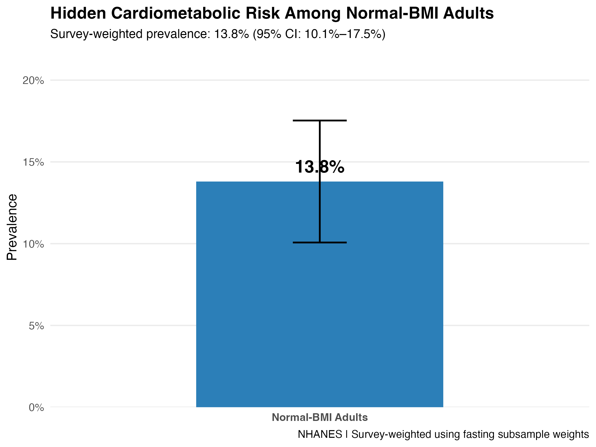
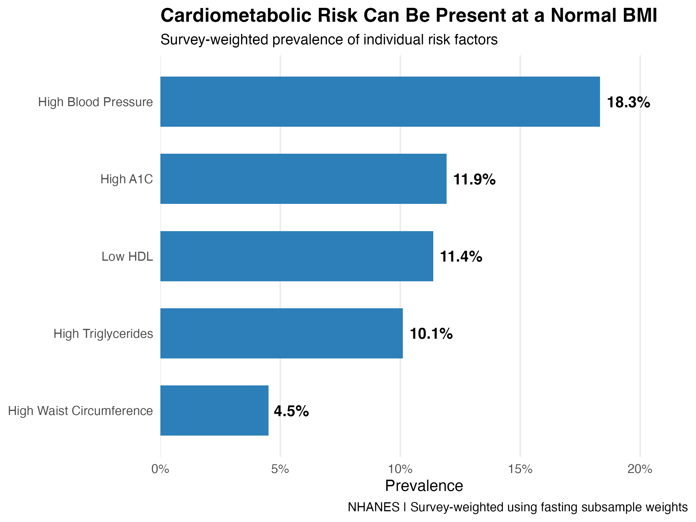
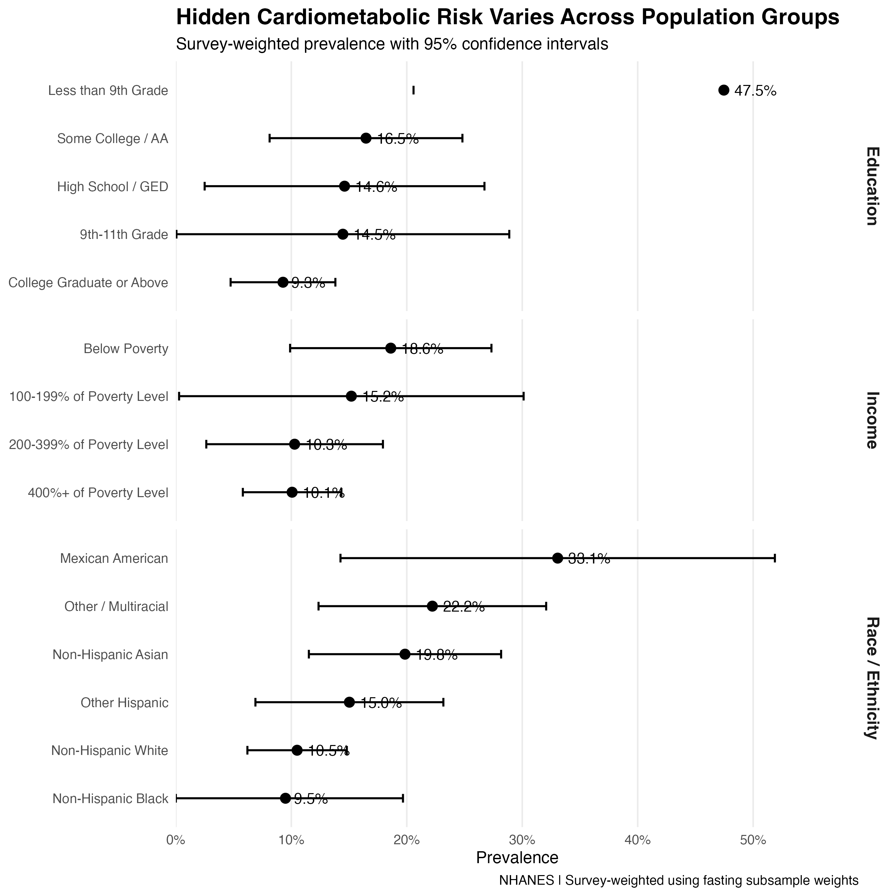
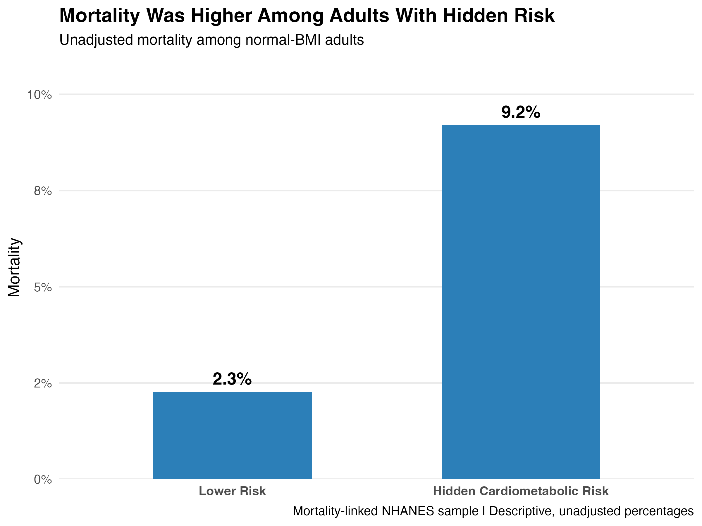

# Beyond BMI: Hidden Cardiometabolic Risk Among Normal-Weight U.S. Adults

## Research Question

How common is hidden cardiometabolic risk among normal-weight U.S. adults, how does it differ across demographic groups, and is it associated with increased mortality?

## Project Overview

Body Mass Index (BMI) is commonly used to assess health, but having a normal BMI does not necessarily mean someone is metabolically healthy.

This project uses data from the National Health and Nutrition Examination Survey (NHANES) to investigate hidden cardiometabolic risk among U.S. adults with a normal BMI.

Specifically, the analysis examines:

- The prevalence of hidden cardiometabolic risk among normal-weight adults
- Differences in hidden risk across income, race/ethnicity, and education
- The relationship between hidden cardiometabolic risk and mortality

The project uses R, survey-weighted statistical analysis, logistic regression, and Cox proportional hazards regression.

## Data

### Primary Analysis

- **Data source:** National Health and Nutrition Examination Survey (NHANES)
- **Survey cycle:** 2021–2023
- **Population:** U.S. adults ages 20–64
- **BMI range:** 18.5–24.9
- **Analytical sample:** 535 participants
- **Survey weights:** NHANES fasting subsample weights

### Mortality Analysis

- **Data source:** NHANES 2005–2018
- **Mortality linkage:** 2019 Public-Use Linked Mortality Files
- **Analytical sample:** 3,368 participants
- **Observed deaths:** 118

The mortality analysis uses a separate historical NHANES sample because mortality follow-up data were not available for the recent cross-sectional sample.

## Methodology

### Defining Hidden Cardiometabolic Risk

Five cardiometabolic indicators were evaluated:

| Risk Factor | Definition |
|---|---|
| Elevated Blood Pressure | Systolic ≥130 mmHg or diastolic ≥80 mmHg |
| Elevated HbA1c | ≥5.7% |
| Elevated Triglycerides | ≥150 mg/dL |
| Low HDL Cholesterol | Men <40 mg/dL; Women <50 mg/dL |
| Elevated Waist Circumference | Men >102 cm; Women >88 cm |

Participants with **two or more** of these five abnormalities were classified as having hidden cardiometabolic risk.

Participants with fewer than two abnormalities were classified as lower risk.

### Statistical Methods

The analysis used:

- Survey-weighted prevalence estimates
- 95% confidence intervals
- Survey-weighted logistic regression
- Cox proportional hazards regression
- Demographic comparisons by income, race/ethnicity, and education
- Data visualization

Survey-weighted logistic regression models examined demographic associations after adjusting for age, sex, and BMI.

The mortality analysis used Cox regression adjusted for age, sex, and BMI.

## Results

### Overall Hidden Cardiometabolic Risk

Among 535 normal-BMI adults, 89 were classified as having hidden cardiometabolic risk.

**Survey-weighted prevalence: 13.8%**

**95% Confidence Interval: 9.7%–17.9%**

This suggests that a meaningful proportion of normal-weight adults have multiple cardiometabolic abnormalities despite having a BMI in the normal range.



### Individual Cardiometabolic Risk Factors

| Risk Factor | Weighted Prevalence |
|---|---:|
| Elevated Blood Pressure | 18.3% |
| Elevated HbA1c | 11.9% |
| Low HDL Cholesterol | 11.4% |
| Elevated Triglycerides | 10.1% |
| Elevated Waist Circumference | 4.5% |

Elevated blood pressure was the most common individual risk factor.



### Hidden Risk by Income

The analysis examined differences in hidden cardiometabolic risk across household income categories.

| Income Group | Weighted Prevalence |
|---|---:|
| Below Poverty | 18.6% |
| 100–199% of Poverty | 15.2% |
| 200–399% of Poverty | 10.3% |
| 400%+ of Poverty | 10.1% |

Adults below the poverty threshold had a higher estimated prevalence of hidden cardiometabolic risk than adults in the highest income category.

After adjusting for age, sex, and BMI:

- **Adjusted Odds Ratio:** 2.56
- **95% CI:** 0.86–7.59

The association was not statistically significant at the 0.05 level.

### Hidden Risk by Race/Ethnicity

| Race/Ethnicity | Weighted Prevalence |
|---|---:|
| Non-Hispanic White | 10.5% |
| Mexican American | 33.1% |
| Other Hispanic | 15.0% |
| Non-Hispanic Black | 9.5% |
| Non-Hispanic Asian | 19.8% |
| Other/Multiracial | 22.2% |

Mexican American adults had the highest estimated prevalence among the categories examined.

After adjusting for age, sex, and BMI:

- **Adjusted Odds Ratio:** 6.81
- **95% CI:** 1.30–35.6
- **Reference Group:** Non-Hispanic White adults

The results suggest an association between race/ethnicity and hidden cardiometabolic risk, although some subgroup estimates had wide confidence intervals.

### Hidden Risk by Education

| Education Level | Weighted Prevalence |
|---|---:|
| Less than 9th Grade | 47.5% |
| 9th–11th Grade | 14.5% |
| High School/GED | 14.6% |
| Some College/Associate Degree | 16.5% |
| College Graduate or Higher | 9.3% |

Adults with less than a ninth-grade education had the highest estimated prevalence.

After adjusting for age, sex, and BMI:

- **Adjusted Odds Ratio:** 7.78
- **95% CI:** 1.68–36.1
- **Reference Group:** College graduates

However, the less-than-ninth-grade group contained only 22 participants, so this estimate should be interpreted cautiously.



### Mortality Analysis

The historical NHANES mortality sample included 3,368 adults and 118 observed deaths.

| Risk Group | Observed Mortality |
|---|---:|
| Lower Cardiometabolic Risk | 2.27% |
| Hidden Cardiometabolic Risk | 9.20% |

A Cox proportional hazards model was used to examine the association between hidden cardiometabolic risk and mortality.

**Adjusted Hazard Ratio: 2.52**

**95% Confidence Interval: 1.72–3.69**

After adjusting for age, sex, and BMI, adults with hidden cardiometabolic risk had approximately 2.52 times the mortality hazard of lower-risk adults during follow-up.

This represents an association rather than evidence that hidden cardiometabolic risk directly caused mortality.



## Key Findings

The analysis provides evidence that normal BMI alone may not fully capture cardiometabolic health.

The main findings were:

- **13.8%** of normal-BMI adults had hidden cardiometabolic risk.
- Elevated blood pressure was the most common individual cardiometabolic abnormality.
- Hidden risk prevalence varied across income, race/ethnicity, and education categories.
- Some demographic differences remained evident after adjusting for age, sex, and BMI.
- The mortality analysis found an adjusted hazard ratio of **2.52**, indicating higher mortality hazard among adults with hidden cardiometabolic risk.

These findings highlight the importance of considering additional health indicators beyond BMI.

## Limitations

This analysis identifies associations rather than causal relationships.

Several limitations should be considered:

- The primary analysis was cross-sectional and cannot establish causation.
- Some demographic subgroups had small sample sizes and wide confidence intervals.
- The primary and mortality analyses used different NHANES survey periods and participant samples.
- The mortality analysis was not survey-weighted.
- Unmeasured factors may influence the observed relationships.
- The cardiometabolic risk definition was based on five selected indicators rather than a clinical diagnosis.

## Reproducibility

This project was developed in RStudio using publicly available NHANES data. The analysis is organized into separate scripts for data preparation, statistical modeling, and visualization.

### Project Structure

```text
BMI_Project/
├── R/
│   ├── 01_data_preparation.R
│   ├── 02_mortality_analysis.R
│   ├── 03_weighted_income_analysis.R
│   ├── 04_weighted_race_analysis.R
│   ├── 05_weighted_education_analysis.R
│   └── 07_final_figures.R
├── data/
├── figures/
├── results/
├── BMI_Project.Rproj
└── README.md
```

The `data/` folder is used for locally downloaded data. Raw mortality files are not included in the public repository.

### R Scripts

| Script | Description |
|---|---|
| `01_data_preparation.R` | Imports and cleans NHANES data, defines cardiometabolic risk factors, and prepares the analytical sample |
| `02_mortality_analysis.R` | Analyzes mortality outcomes using Cox proportional hazards regression |
| `03_weighted_income_analysis.R` | Estimates hidden risk prevalence and adjusted associations by income |
| `04_weighted_race_analysis.R` | Estimates hidden risk prevalence and adjusted associations by race/ethnicity |
| `05_weighted_education_analysis.R` | Estimates hidden risk prevalence and adjusted associations by education |
| `07_final_figures.R` | Generates the final project visualizations |

### How to Reproduce the Analysis

**1. Download the repository**

Clone or download this GitHub repository and open `BMI_Project.Rproj` in RStudio.

**2. Install the required R packages**

```r
install.packages(c(
  "nhanesdata",
  "dplyr",
  "survey",
  "survival",
  "broom",
  "ggplot2",
  "scales"
))
```

**3. Prepare the mortality data**

Download the 2019 Public-Use Linked Mortality Files for NHANES 2005–2018 from the [CDC Linked Mortality Files directory](https://ftp.cdc.gov/pub/health_statistics/NCHS/datalinkage/linked_mortality/).

Place the seven NHANES mortality `.dat` files in the `data/` folder.

These raw mortality files are not included in the GitHub repository.

**4. Run the analysis**

Run the scripts in the following order from the RStudio project directory:

```r
source("R/01_data_preparation.R")
source("R/02_mortality_analysis.R")
source("R/03_weighted_income_analysis.R")
source("R/04_weighted_race_analysis.R")
source("R/05_weighted_education_analysis.R")
source("R/07_final_figures.R")
```

**5. View the results**

The analysis generates:

- `results/` — Statistical summaries, prevalence estimates, odds ratios, and mortality model results
- `figures/` — Four visualizations showing overall hidden risk, individual risk factors, demographic differences, and mortality

The results and figures are included in the repository for reference.

### Data Availability

NHANES data are publicly available through the [CDC NHANES website](https://www.cdc.gov/nchs/nhanes/).

Historical mortality linkage files are available through the [CDC Linked Mortality Files directory](https://ftp.cdc.gov/pub/health_statistics/NCHS/datalinkage/linked_mortality/).

## Tools

- R
- RStudio
- NHANES
- nhanesdata
- dplyr
- survey
- survival
- broom
- ggplot2
- Survey-Weighted Logistic Regression
- Cox Proportional Hazards Regression
- Confidence Intervals
- Data Visualization
